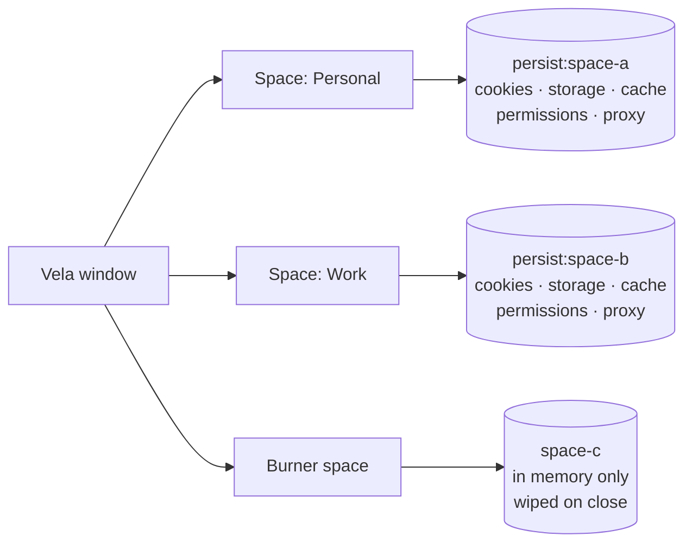

<div align="center">


# Vela

**Fast. Quiet. Isolated.**

A minimal Chromium-based desktop browser with sandboxed multi-session Spaces.

[](https://github.com/Aepzie/vela/actions/workflows/ci.yml)
[](https://github.com/Aepzie/vela/releases)
[](LICENSE)

[Install](#install) · [Features](#features) · [Shortcuts](#keyboard-shortcuts) · [Architecture](docs/ARCHITECTURE.md) · [Contributing](CONTRIBUTING.md)

</div>

---

## Why Vela

Most browsers grow heavier with every release: more panels, more services, more background work.
Vela goes the other way. It keeps the browser chrome small and out of the way, blocks ads and trackers
at the network level, puts idle tabs to sleep, and gives you **Spaces** — fully separate browsing
contexts for work, personal, client accounts or throwaway sessions, in one window.

No account, no telemetry, no sync servers. Just the web, out of the way.

## Features

- **Spaces** — isolated sessions with their own cookies, storage, cache, logins, permissions and optional proxy.
- **Burner spaces** — live only in memory and are wiped when closed. Open one with `Ctrl+Shift+N`.
- **Built-in ad and tracker blocking** — network-level, powered by the [Ghostery adblocker](https://github.com/ghostery/adblocker) engine.
- **Tab sleeping** — idle tabs release their renderer process entirely; they reload when you come back.
- **Lazy session restore** — restored tabs stay asleep until you open them.
- **Preconnect on hover** — hovering a suggestion warms up the connection before you choose it.
- **Command palette** (`Ctrl+K`) — navigate, search history, switch tabs and run commands from the keyboard.
- **Floating Islands UI** — a detached glass toolbar hovering over the desktop (Windows 11 Mica / Acrylic), the active tab doubles as the address bar and morphs into the command palette. Focus mode hides the toolbar entirely. Built with React, Tailwind CSS, shadcn/ui and Motion.
- Find bar, zoom, downloads with a live progress ring, and DevTools.
- **Privacy defaults** — cleaned user agent, permissions denied by default, HTTPS-only upgrades,
  optional Do Not Track / Global Privacy Control and third-party cookie blocking.

### Spaces, explained

Every Space is backed by its own Chromium **session partition**. Tabs in different Spaces cannot see each
other's cookies or storage — you can be signed in to two accounts on the same site side by side.



| Space type | Partition            | Stored         | Lifetime                              |
|------------|----------------------|----------------|---------------------------------------|
| Regular    | `persist:space-<id>` | on disk        | survives restarts                     |
| Burner     | `space-<id>`         | in memory only | wiped when the space is closed or Vela quits |

## Performance

Vela uses the same Chromium engine as Chrome (via Electron), so **JavaScript and rendering benchmarks
are roughly equal to Chrome**. Vela does not claim a faster engine. The gains come from doing less:

- **Memory** — sleeping tabs have their renderer destroyed, not just throttled, so a large tab count
  costs little RAM. Under system memory pressure the oldest idle tabs are put to sleep first.
- **Bytes and requests** — ads and trackers are blocked before they are fetched, which reduces data
  transferred and main-thread work on ad-heavy pages.
- **Startup** — a small, code-split UI bundle and lazy session restore mean only the active tab loads at launch.

Methodology and how to reproduce measurements: [docs/PERFORMANCE.md](docs/PERFORMANCE.md).

## Keyboard shortcuts

On macOS, use `Cmd` in place of `Ctrl`.

| Shortcut                  | Action                              |
|---------------------------|-------------------------------------|
| `Ctrl+T`                  | New tab (opens the command palette) |
| `Ctrl+K`                  | Command palette                     |
| `Ctrl+L`                  | Focus address                       |
| `Ctrl+W`                  | Close tab                           |
| `Ctrl+Shift+T`            | Reopen closed tab                   |
| `Ctrl+F`                  | Find in page                        |
| `Ctrl+Shift+S`            | Toggle focus mode (hide toolbar)    |
| `Ctrl+Shift+N`            | New Burner space                    |
| `Ctrl+1` – `Ctrl+9`       | Switch to tab 1–9                   |
| `Ctrl+Tab` / `Ctrl+Shift+Tab` | Next / previous tab             |
| `Ctrl+=` / `Ctrl+-` / `Ctrl+0` | Zoom in / out / reset          |
| `F12`                     | Developer tools                     |
| `F11`                     | Fullscreen                          |

## Install

### Download

Prebuilt installers are published on the [Releases page](https://github.com/Aepzie/vela/releases):

| Platform | Formats                                  |
|----------|------------------------------------------|
| Windows  | `setup.exe` (NSIS installer), portable `.exe` |
| macOS    | `.dmg` for Apple Silicon (arm64) and Intel (x64) |
| Linux    | `.AppImage`, `.deb`                      |

Early builds are not code-signed yet, so Windows SmartScreen and macOS Gatekeeper may warn on first launch.

### Build from source

Requires Node.js 20 or newer.

```bash
git clone https://github.com/Aepzie/vela.git
cd vela
npm install
npm run dev      # build and launch
npm run dist     # build installers for your OS into release/
```

See [CONTRIBUTING.md](CONTRIBUTING.md) for all scripts.

## Architecture

Vela is an Electron app. The browser chrome is a small TypeScript UI in one `WebContentsView`; each web page
runs in its own sandboxed `WebContentsView`, and only the active tab is attached to the window. Main-process
modules handle tabs, Spaces, IPC, the `vela://` protocol, privacy and performance features.

Full details, including module contracts: [docs/ARCHITECTURE.md](docs/ARCHITECTURE.md).

## Security model

- **Sandboxed web content** — every tab runs with `sandbox: true`, `contextIsolation: true` and
  `nodeIntegration: false`, with Chromium site isolation enabled.
- **Minimal preloads** — preload scripts expose narrow, typed APIs via `contextBridge`; web pages never get Node.js access.
- **IPC sender validation** — main-process handlers verify which `webContents` sent each message, so ordinary web
  pages cannot call browser-chrome APIs.
- **Privileged `vela://` pages** — internal pages (new tab, settings, error) are served from the app bundle through a
  custom protocol with path-traversal protection, isolated from regular web origins.
- **Partition isolation** — Spaces never share session state; Burner spaces are never written to disk.

Found a vulnerability? Please follow [SECURITY.md](SECURITY.md).

## Roadmap

Planned, not yet available:

- [ ] Extension support
- [ ] Optional end-to-end encrypted sync
- [ ] Vertical tab groups
- [ ] Split view
- [ ] Per-space fingerprint protection
- [ ] Auto-update

Ideas and discussion are welcome in [issues](https://github.com/Aepzie/vela/issues).

## Contributing

Contributions of all sizes are welcome — bug reports, fixes, docs and features. Start with
[CONTRIBUTING.md](CONTRIBUTING.md) and the [Code of Conduct](CODE_OF_CONDUCT.md).

## License

[MIT](LICENSE) © 2026 Vela contributors.

Vela is built on [Electron](https://www.electronjs.org/) and [Chromium](https://www.chromium.org/).
Ad blocking uses [@ghostery/adblocker](https://github.com/ghostery/adblocker) (MPL-2.0).
