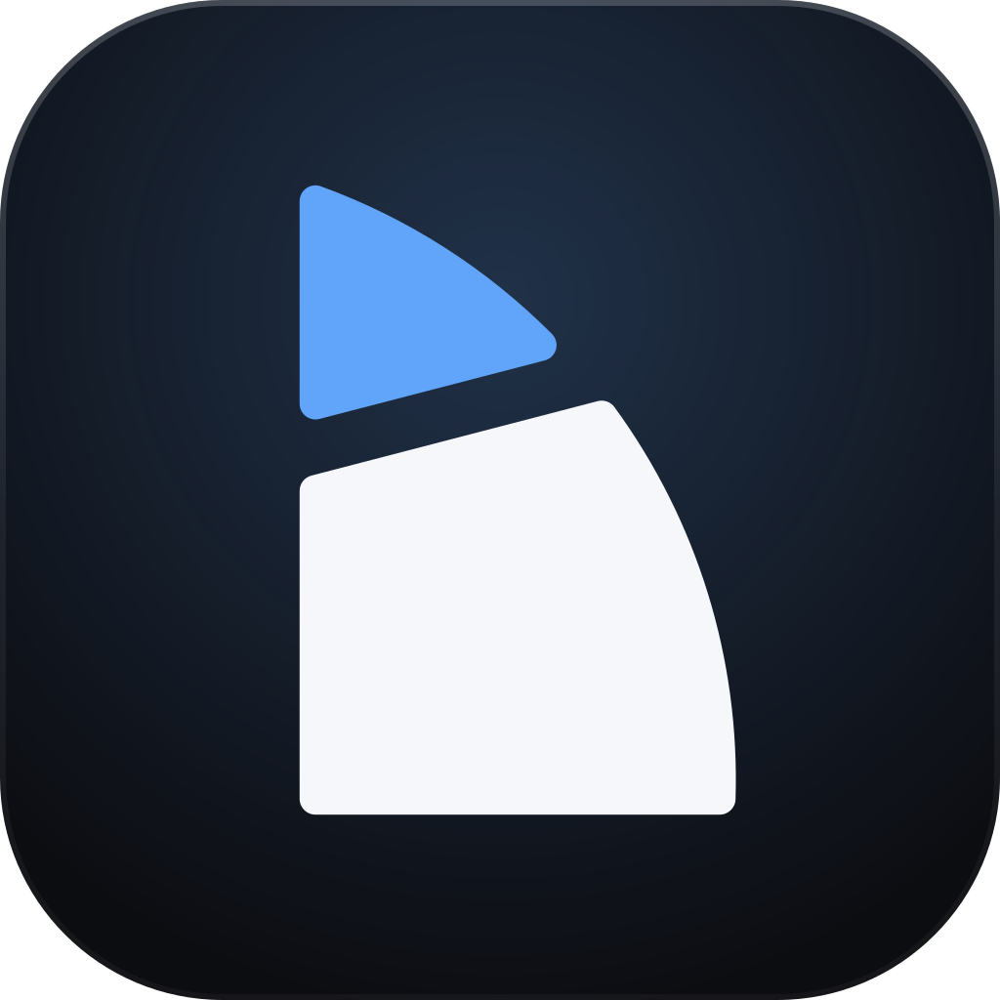
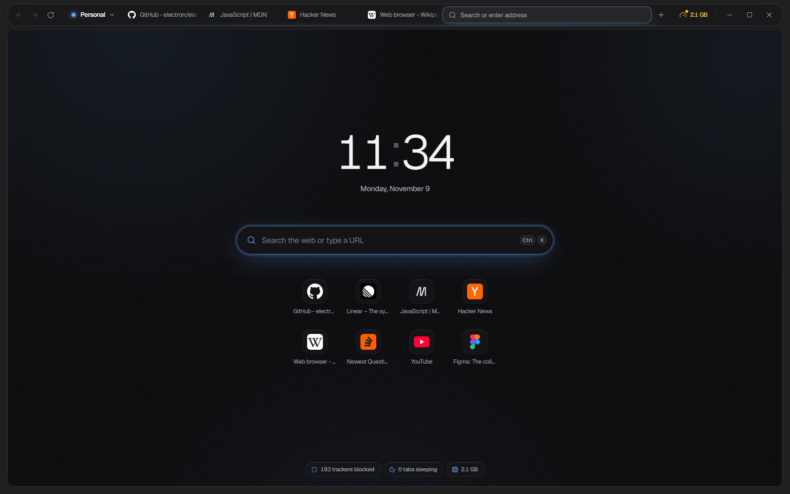
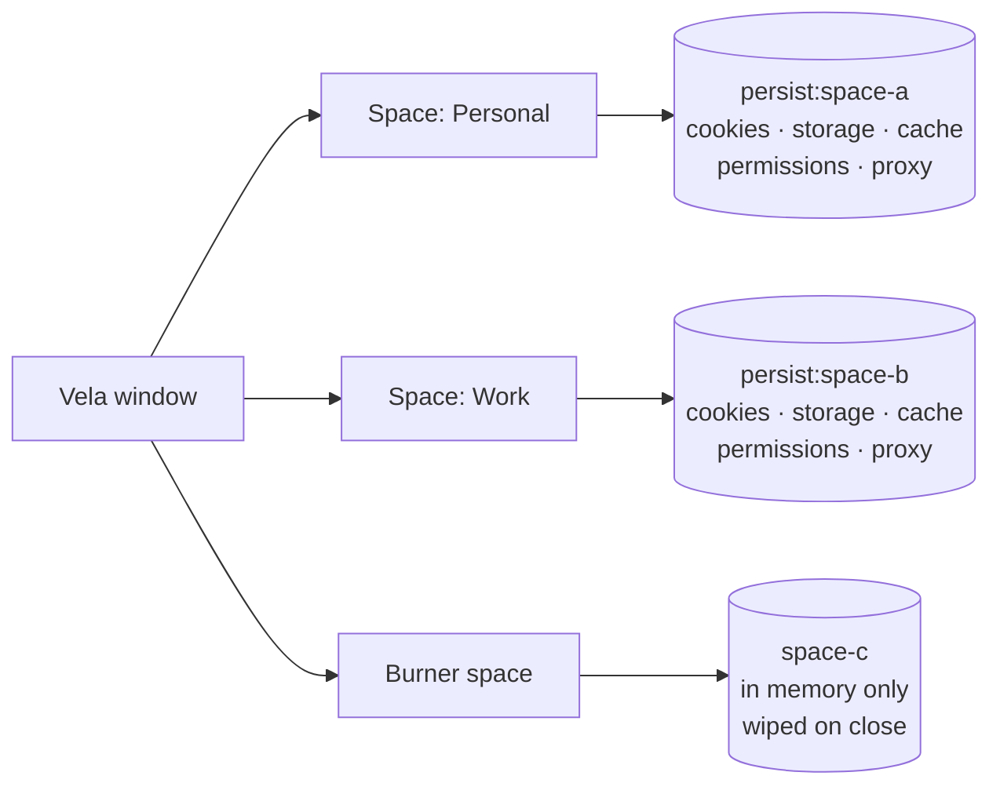
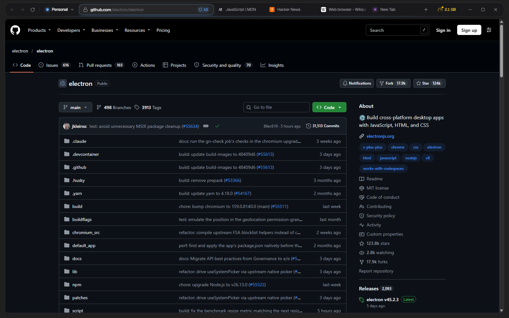
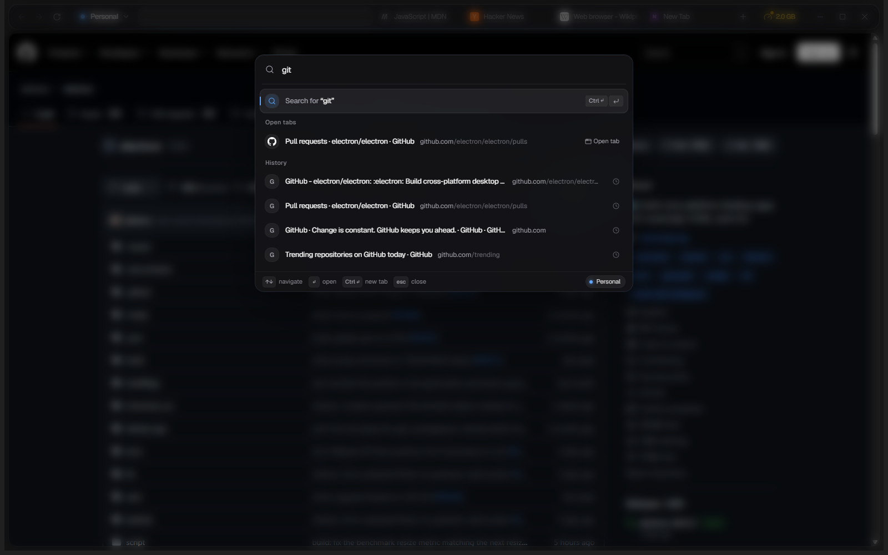
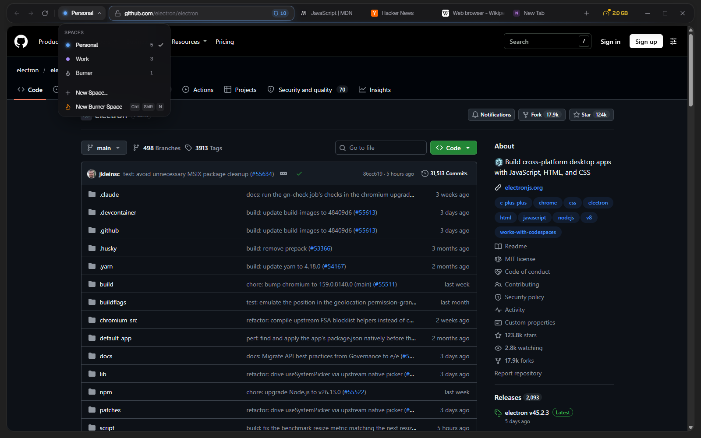
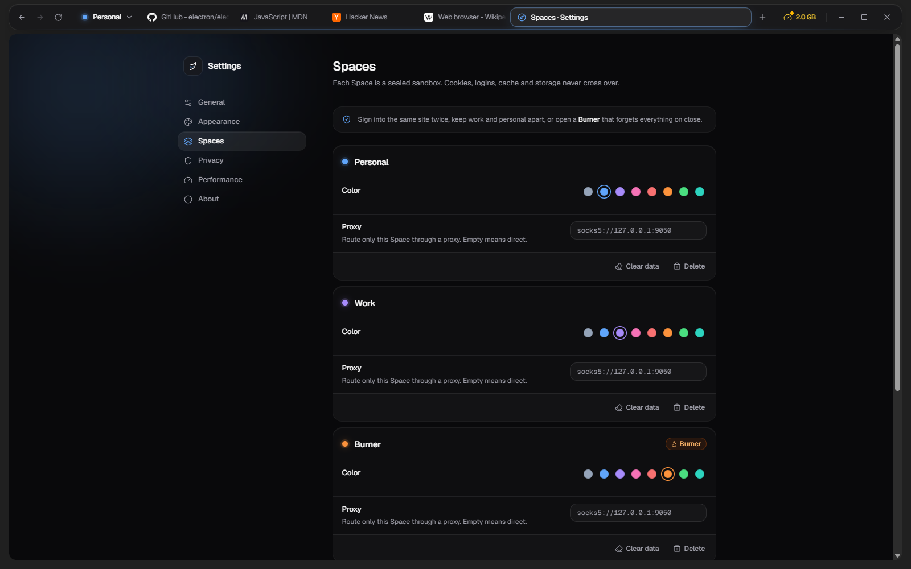
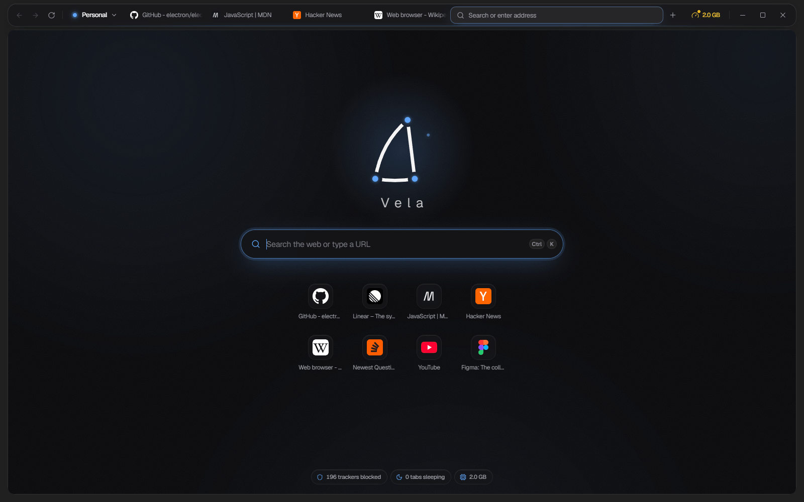
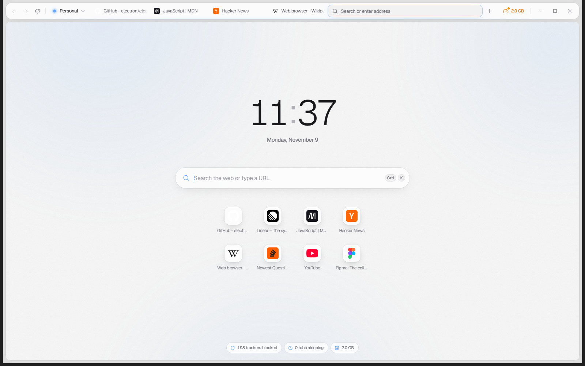
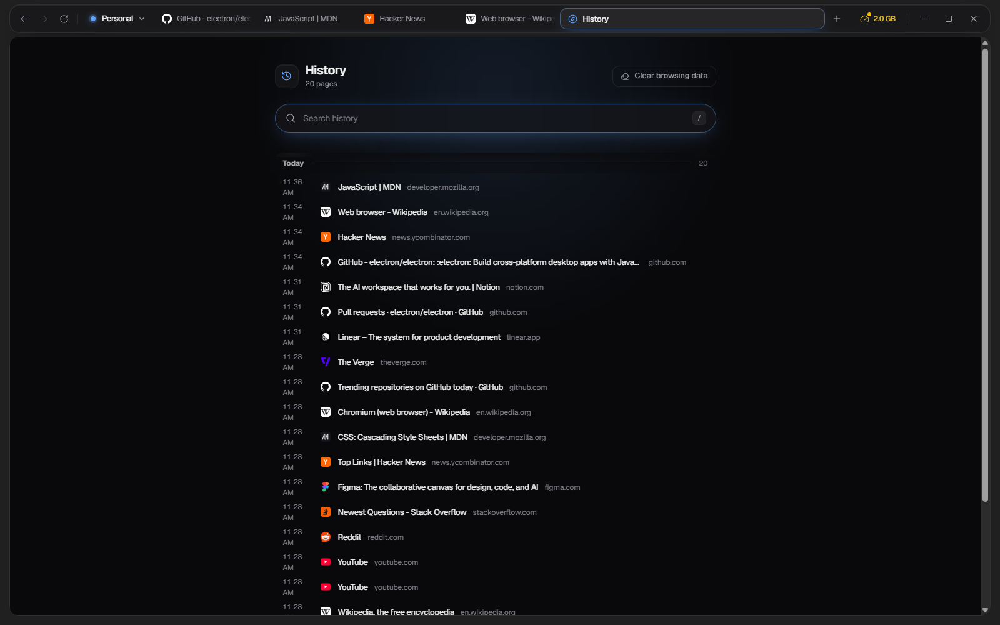

<div align="center">



# Vela

**Fast. Quiet. Isolated.**

A minimal Chromium-based desktop browser with sandboxed multi-session Spaces.

[](https://github.com/Aepzie/vela/actions/workflows/ci.yml)
[](https://github.com/Aepzie/vela/releases)
[](LICENSE)

[Download](#download) · [Features](#features) · [Screenshots](#screenshots) · [Shortcuts](#keyboard-shortcuts) · [Architecture](docs/ARCHITECTURE.md) · [Contributing](CONTRIBUTING.md)

</div>

<p align="center">
  
</p>

## Download

**[Download the latest release](https://github.com/Aepzie/vela/releases/latest)**

| Platform | File |
|----------|------|
| Windows (installer) | [`Vela-0.1.0-setup-x64.exe`](https://github.com/Aepzie/vela/releases/latest) |
| Windows (portable) | [`Vela-0.1.0-portable-x64.exe`](https://github.com/Aepzie/vela/releases/latest) — no install, runs from a USB stick |
| macOS / Linux | `.dmg`, `.AppImage` and `.deb` builds are produced by CI and attached to the [same release page](https://github.com/Aepzie/vela/releases/latest) |

Builds are not code-signed yet. On Windows, SmartScreen may show a warning on first launch — click
**More info → Run anyway**. macOS Gatekeeper may warn as well.

**Updates:** the Windows installer and the Linux AppImage update themselves — new versions download in the
background and install when you restart Vela (or click **Update ready · Restart** in the toolbar). The portable
`.exe`, the `.deb` and the (unsigned) macOS build only tell you when a new version is out and link to the
release page. Configure it in **Settings → About → Updates**.

---

## Why Vela

Most browsers grow heavier with every release: more panels, more services, more background work.
Vela goes the other way. It keeps the browser chrome small and out of the way, blocks ads and trackers
at the network level, puts idle tabs to sleep, and gives you **Spaces** — fully separate browsing
contexts for work, personal, client accounts or throwaway sessions, in one window.

No account, no telemetry, no sync servers. Just the web, out of the way.

## Features

- **Spaces** — isolated sessions with their own cookies, storage, cache, logins, permissions and optional proxy.
- **Burner spaces** — live only in memory and are wiped when closed. Open one with `Ctrl+Shift+N`.
- **Per-space fingerprint protection** — each Space shows sites its own stable, plausible fingerprint (canvas, WebGL, audio, hardware; Strict also screen, devices, client hints), so identities can't be linked across Spaces.
- **Built-in ad and tracker blocking** — network-level, powered by the [Ghostery adblocker](https://github.com/ghostery/adblocker) engine.
- **Chrome extensions** — install from the Chrome Web Store (link or ID) or load unpacked; pin action buttons to the toolbar and choose which Spaces each extension runs in.
- **Tab sleeping** — idle tabs release their renderer process entirely; they reload when you come back.
- **Lazy session restore** — restored tabs stay asleep until you open them.
- **Preconnect on hover** — hovering a suggestion warms up the connection before you choose it.
- **Command palette** (`Ctrl+K`) — navigate, search history, switch tabs and run commands from the keyboard.
- **Floating Islands UI** — a detached glass toolbar hovering over the desktop (Windows 11 Mica / Acrylic), the active tab doubles as the address bar and morphs into the command palette. Focus mode hides the toolbar entirely. Built with React, Tailwind CSS, shadcn/ui and Motion.
- **Tab groups and vertical tabs** — named, colored, collapsible groups (drag tabs in and out, reorder groups), and an optional floating vertical tab island (`Ctrl+Shift+,`) that resizes and folds to an icon rail.
- **Split view** — two tabs side by side (up to four in a 2×2 grid) with a draggable divider; the focused pane drives the address bar, find and zoom. Drag a tab onto the edge of the page, use the tab menu or `Ctrl+Shift+D`. Splits show as one joined tab and come back with the session.
- **Optional end-to-end encrypted sync** — settings, Spaces, open tabs and (opt-in) history through a folder you already sync (OneDrive, Dropbox, iCloud, Syncthing) or your own WebDAV server; no Vela server, off by default.
- **Per-tab audio devices** — send each tab to its own speakers or headphones and pick its microphone (and camera) from the tab menu or the tab's speaker indicator; restored with the session.
- **Per-tab audio mixer** (`Ctrl+Shift+M`) — every tab that plays sound gets a channel strip with volume up to 200 %, balance, mute, solo and live meters; plus a 10-band equalizer with presets, bass boost, mono, an "even out volume" compressor and its speaker / microphone, from the mixer button in the toolbar.
- Find bar, zoom, downloads with a live progress ring, and DevTools.
- **Auto-update** — checks GitHub releases quietly in the background, shows what's new, and installs on restart (optional pre-releases).
- **Android app** — a native Vela for phones with the same Spaces, Burner spaces, sleeping tabs and privacy defaults ([details](#android)).
- **Privacy defaults** — cleaned user agent, permissions denied by default, HTTPS-only upgrades,
  optional Do Not Track / Global Privacy Control and third-party cookie blocking.

### Spaces, explained

Every Space is backed by its own Chromium **session partition**. Tabs in different Spaces cannot see each
other's cookies or storage — you can be signed in to two accounts on the same site side by side.



| Space type | Partition            | Stored         | Lifetime                              |
|------------|----------------------|----------------|---------------------------------------|
| Regular    | `persist:space-<id>` | on disk        | survives restarts                     |
| Burner     | `space-<id>`         | in memory only | wiped when the space is closed or Vela quits |

## Screenshots

<table>
  <tr>
    <td width="50%"><br><sub><b>Floating island toolbar</b> — tabs, address bar and the blocked-tracker badge in one row.</sub></td>
    <td width="50%"><br><sub><b>Command palette</b> (<code>Ctrl+K</code>) — open tabs, history and search from one box.</sub></td>
  </tr>
  <tr>
    <td width="50%"><br><sub><b>Spaces</b> — switch between isolated sessions, or open a Burner that forgets everything.</sub></td>
    <td width="50%"><br><sub><b>Per-Space settings</b> — color, optional proxy, clear data.</sub></td>
  </tr>
  <tr>
    <td width="50%"><br><sub><b>New tab styles</b> — clock, logo, date, greeting or minimal.</sub></td>
    <td width="50%"><br><sub><b>Light theme</b> — or follow the system setting.</sub></td>
  </tr>
  <tr>
    <td width="50%"><br><sub><b>History</b> — searchable, grouped by day.</sub></td>
    <td width="50%"></td>
  </tr>
</table>

## Performance

Vela uses the same Chromium engine as Chrome (via Electron), so **JavaScript and rendering benchmarks
are roughly equal to Chrome**. Vela does not claim a faster engine. The gains come from doing less:

- **Memory** — sleeping tabs have their renderer destroyed, not just throttled, so a large tab count
  costs little RAM. Under system memory pressure the oldest idle tabs are put to sleep first.
- **Bytes and requests** — ads and trackers are blocked before they are fetched, which reduces data
  transferred and main-thread work on ad-heavy pages.
- **Startup** — a small, code-split UI bundle and lazy session restore mean only the active tab loads at launch.

Methodology and how to reproduce measurements: [docs/PERFORMANCE.md](docs/PERFORMANCE.md).

## Keyboard shortcuts

On macOS, use `Cmd` in place of `Ctrl`.

| Shortcut                  | Action                              |
|---------------------------|-------------------------------------|
| `Ctrl+T`                  | New tab (opens the command palette) |
| `Ctrl+K`                  | Command palette                     |
| `Ctrl+L`                  | Focus address                       |
| `Ctrl+W`                  | Close tab                           |
| `Ctrl+Shift+T`            | Reopen closed tab                   |
| `Ctrl+F`                  | Find in page                        |
| `Ctrl+Shift+S`            | Toggle focus mode (hide toolbar)    |
| `Ctrl+Shift+,`            | Toggle horizontal / vertical tabs   |
| `Ctrl+Shift+D`            | Split view on / off                 |
| `Ctrl+Shift+N`            | New Burner space                    |
| `Ctrl+Shift+M`            | Audio mixer                         |
| `Ctrl+1` – `Ctrl+9`       | Switch to tab 1–9                   |
| `Ctrl+Tab` / `Ctrl+Shift+Tab` | Next / previous tab             |
| `Ctrl+=` / `Ctrl+-` / `Ctrl+0` | Zoom in / out / reset          |
| `F12`                     | Developer tools                     |
| `F11`                     | Fullscreen                          |

## Install

### Download

See [Download](#download) above, or browse all versions on the [Releases page](https://github.com/Aepzie/vela/releases):

| Platform | Formats                                  |
|----------|------------------------------------------|
| Windows  | `setup.exe` (NSIS installer), portable `.exe` |
| macOS    | `.dmg` for Apple Silicon (arm64) and Intel (x64) |
| Linux    | `.AppImage`, `.deb`                      |

### Build from source

Requires Node.js 20 or newer.

```bash
git clone https://github.com/Aepzie/vela.git
cd vela
npm install
npm run dev      # build and launch
npm run dist     # build installers for your OS into release/
```

See [CONTRIBUTING.md](CONTRIBUTING.md) for all scripts.

## Android

Vela also runs on Android 10+ as a native app (Kotlin + Jetpack Compose on Android System WebView), in
[`android/`](android/):

- **Floating bottom island** — back/forward, address bar with search suggestions from history, tab count and menu;
  it shrinks to a small address pill while you read and springs back when you scroll up.
- **Spaces and Burner spaces** — each Space has its own WebView profile (cookies, storage, cache, permissions);
  a Burner forgets everything when you close it.
- **Tabs that sleep** — idle tabs release their WebView and wake up when you return; tabs are restored on launch.
- **Desktop-style new tab page** — tap the clock to cycle clock, seconds, logo, date, greeting and minimal.
- **Privacy defaults** — HTTPS-only, third-party cookies blocked, Do Not Track / GPC, Safe Browsing, in-app
  permission prompts, no cloud backup.

Build it with `cd android && ./gradlew :app:assembleDebug` (JDK 17+, Android SDK 37). See
[android/README.md](android/README.md) for release signing and architecture.

## Architecture

Vela is an Electron app. The browser chrome is a small TypeScript UI in one `WebContentsView`; each web page
runs in its own sandboxed `WebContentsView`, and only the active tab is attached to the window. Main-process
modules handle tabs, Spaces, IPC, the `vela://` protocol, privacy and performance features.

Full details, including module contracts: [docs/ARCHITECTURE.md](docs/ARCHITECTURE.md).

## Security model

- **Sandboxed web content** — every tab runs with `sandbox: true`, `contextIsolation: true` and
  `nodeIntegration: false`, with Chromium site isolation enabled.
- **Minimal preloads** — preload scripts expose narrow, typed APIs via `contextBridge`; web pages never get Node.js access.
- **IPC sender validation** — main-process handlers verify which `webContents` sent each message, so ordinary web
  pages cannot call browser-chrome APIs.
- **Privileged `vela://` pages** — internal pages (new tab, settings, error) are served from the app bundle through a
  custom protocol with path-traversal protection, isolated from regular web origins.
- **Partition isolation** — Spaces never share session state; Burner spaces are never written to disk.

Found a vulnerability? Please follow [SECURITY.md](SECURITY.md).

## Roadmap

Planned:

- [ ] Signed builds (Windows, macOS)
- [ ] Extension `declarativeNetRequest` support (uBlock Origin Lite)
- [ ] Fingerprint protection inside workers

Ideas and discussion are welcome in [issues](https://github.com/Aepzie/vela/issues).

## Contributing

Contributions of all sizes are welcome — bug reports, fixes, docs and features. Start with
[CONTRIBUTING.md](CONTRIBUTING.md) and the [Code of Conduct](CODE_OF_CONDUCT.md).

## License

[MIT](LICENSE) © 2026 Vela contributors.

Vela is built on [Electron](https://www.electronjs.org/) and [Chromium](https://www.chromium.org/).
Ad blocking uses [@ghostery/adblocker](https://github.com/ghostery/adblocker) (MPL-2.0).
