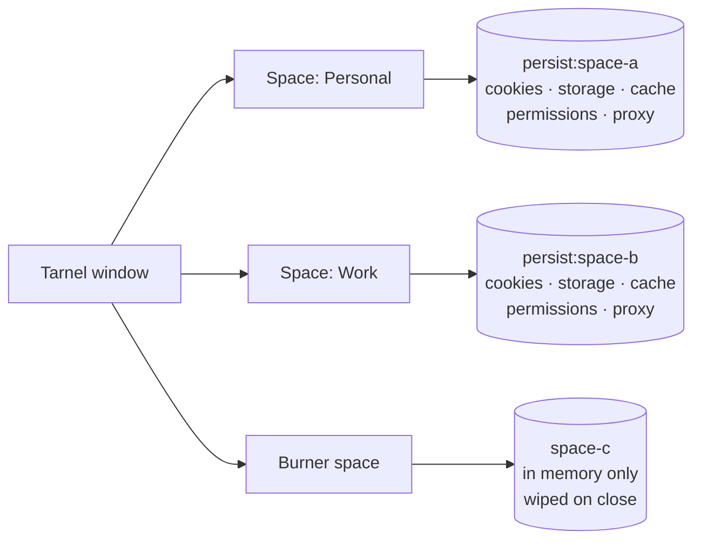

# Tarnel features

Everything Tarnel does, in one place. The [README](../README.md) has the short version; the
[CHANGELOG](../CHANGELOG.md) has the details per release, and [ARCHITECTURE.md](ARCHITECTURE.md) explains how it works.

- [Spaces](#spaces)
- [Privacy and security](#privacy-and-security)
- [Browsing](#browsing)
- [Performance](#performance)
- [Your data](#your-data)
- [Keyboard shortcuts](#keyboard-shortcuts)
- [Android](#android)
- [Security model](#security-model)

## Spaces

Every Space is backed by its own Chromium **session partition**. Tabs in different Spaces cannot see each
other's cookies or storage, so you can be signed in to two accounts on the same site side by side.

| Space type | Partition            | Stored         | Lifetime                                     |
|------------|----------------------|----------------|----------------------------------------------|
| Regular    | `persist:space-<id>` | on disk        | survives restarts                            |
| Burner     | `space-<id>`         | in memory only | wiped when the space is closed or Tarnel quits |

- **Spaces**: isolated sessions with their own cookies, storage, cache, logins, permissions and optional proxy.
- **Burner spaces**: live only in memory and are wiped when closed. Open one with `Ctrl+Shift+N`.
- **Per-space fingerprint protection**: each Space shows sites its own stable, plausible fingerprint (canvas, WebGL,
  audio, hardware, consistently in workers too; Strict also screen, devices, client hints), so identities can't be
  linked across Spaces.
- **Per-Space timezone and language**: Automatic, System, UTC, match the VPN country, or a fixed zone.
- **Per-Space passwords and bookmarks**: one password vault per Space, encrypted by your operating system; Burner
  Spaces keep both in memory only.
- **MantelVPN per Space or per tab**: route a whole Space, or a single tab, through a Mantel location.
- **Site rules** (Settings → Rules): open a domain in a given Space, route it through a VPN country, set its
  fingerprint level or user agent, or block it, before the page loads.
- **Panic button** (`Ctrl+Shift+Delete`): hides Tarnel, mutes every tab and wipes every Burner Space.

## Privacy and security

- **Protected content (DRM)**: Settings → Privacy → "Protected content (DRM)", off by default. Consent stays on this device; changes need a restart. Release builds use stock Electron and do not include a DRM-capable runtime; an optional [development runtime](RELEASING.md#optional-widevine-development-runtime) is available. Status reports local Widevine readiness, without guaranteeing service compatibility. DRM players embedded in iframes are blocked even when DRM is on. Open pages can continue using DRM until restart. The component applies to the whole app, including Burner Spaces, without complete DRM isolation between Spaces.
- **Built-in ad and tracker blocking**: network-level, powered by the
  [Ghostery adblocker](https://github.com/ghostery/adblocker) engine.
- **Cookie banners rejected**: consent pop-ups from common consent tools are answered with "reject" / "only
  necessary" and hidden (DuckDuckGo's autoconsent rules, bundled; nothing is fetched or sent).
- **Phishing and malware protection**: pages are checked locally against public block lists; nothing you visit is
  sent anywhere.
- **Privacy report** (`tarnel://privacy`): trackers, ads and tracking parameters blocked this week vs last week, counted
  on this device only.
- **On-device translation**: pages are translated locally with Mozilla's Firefox Translations engine (Bergamot); no
  page text leaves the device.
- **Email aliases**: connect SimpleLogin or addy.io and Tarnel offers an alias when you focus a sign-up form's email
  field.
- **Secure DNS** (DNS-over-HTTPS): Cloudflare, Quad9, Mullvad, NextDNS or a custom template, optionally strict.
- **Privacy defaults**: cleaned user agent, permissions denied by default, HTTPS-only upgrades, optional Do Not Track
  / Global Privacy Control and third-party cookie blocking.

## Browsing

- **Command palette** (`Ctrl+K`): navigate, search history, switch tabs and run commands from the keyboard.
- **Floating Islands UI**: a detached glass toolbar hovering over the desktop (Windows 11 Mica / Acrylic); the active
  tab doubles as the address bar and morphs into the command palette. Focus mode hides the toolbar entirely. Built
  with React, Tailwind CSS, shadcn/ui and Motion.
- **Split view**: two tabs side by side (up to four in a 2×2 grid) with a draggable divider; the focused pane drives
  the address bar, find and zoom. Drag a tab onto the edge of the page, use the tab menu or `Ctrl+Shift+D`. Splits
  show as one joined tab and come back with the session.
- **Peek**: shift-click a link to preview it in a floating window over the page; open it as a tab (no reload) or in
  split view, Esc to dismiss.
- **Web panels**: pin web apps (chat, music, calendar, any URL) to a slim rail on the right and open them beside the
  page in a resizable side view. Each panel has its own isolated session and an optional mobile layout, shows unread
  counts, and sleeps like a tab when you haven't used it (never while it plays music).
- **Tab groups and vertical tabs**: named, colored, collapsible groups (drag tabs in and out, reorder groups), and an
  optional floating vertical tab island (`Ctrl+Shift+,`) that resizes and folds to an icon rail.
- **Tab archive**: tabs you haven't used for a while (Settings → Performance: off, 6 h … 1 week; 24 h by default;
  pinned tabs never) move out of the strip into the Space's archive instead of piling up. Archive by hand with
  `Ctrl+Shift+E` or the tab / group menu; search, restore (back into its group) or clear it from the archive button,
  the palette or its suggestions, next to your recently closed tabs.
- **Screenshots** (`Ctrl+Shift+X`): area, visible part or full page, then a small editor: crop, arrows, boxes, pen,
  text, highlighter and blur for personal data; copy or save as PNG/JPEG.
- **Chrome extensions**: install from the Chrome Web Store (link or ID), the curated `tarnel://extensions` catalog, or
  load unpacked; pin action buttons to the toolbar and choose which Spaces each extension runs in. Manifest V3
  content blockers work: Tarnel implements `declarativeNetRequest`, so
  [uBlock Origin Lite](https://chromewebstore.google.com/detail/ddkjiahejlhfcafbddmgiahcphecmpfh) blocks with its
  static, dynamic and per-site rules (you can turn the built-in blocker off in Settings if you prefer it).
- **Per-tab audio devices**: send each tab to its own speakers or headphones and pick its microphone (and camera) from
  the tab menu or the tab's speaker indicator; restored with the session.
- **Per-tab audio mixer** (`Ctrl+Shift+M`): every tab that plays sound gets a channel strip with volume up to 200 %,
  balance, mute, solo and live meters; plus a 10-band equalizer with presets, bass boost, mono, an "even out volume"
  compressor and its speaker / microphone, from the mixer button in the toolbar.
- **Task manager** (`Shift+Esc`): CPU and memory per tab, extension and browser process.
- Find bar, zoom, downloads with a live progress ring, and DevTools.

## Performance

Tarnel uses the same Chromium engine as Chrome (via Electron), so **JavaScript and rendering benchmarks are roughly
equal to Chrome**. Tarnel does not claim a faster engine. The gains come from doing less:

- **Memory**: sleeping tabs have their renderer destroyed, not just throttled, so a large tab count costs little RAM.
  Under system memory pressure the oldest idle tabs are put to sleep first.
- **Bytes and requests**: ads and trackers are blocked before they are fetched, which reduces data transferred and
  main-thread work on ad-heavy pages.
- **Startup**: a small, code-split UI bundle and lazy session restore mean only the active tab loads at launch.
- **Tab sleeping**: idle tabs release their renderer process entirely; they reload when you come back.
- **Lazy session restore**: restored tabs stay asleep until you open them.
- **Preconnect on hover**: hovering a suggestion warms up the connection before you choose it.
- **Battery saver** (Settings → Performance): background tabs freeze and sleep sooner on battery; security features
  are never reduced.

Methodology and how to reproduce measurements: [PERFORMANCE.md](PERFORMANCE.md).

## Your data

- **No account, no telemetry, no sync servers.**
- **Optional end-to-end encrypted sync**: settings, Spaces, open tabs and (opt-in) history through a folder you
  already sync (OneDrive, Dropbox, iCloud, Syncthing) or your own WebDAV server; no Tarnel server, off by default.
- **Import** (Settings → Import): bookmarks and recent history from Chrome, Edge, Brave, Vivaldi, Opera, Chromium and
  Firefox; passwords from a CSV export.
- **Auto-update**: checks GitHub releases quietly in the background, shows what's new, and installs on restart
  (optional pre-releases). The Windows installer and the Linux AppImage update themselves; the portable `.exe`, the
  `.deb` and the (unsigned) macOS build only tell you when a new version is out and link to the release page.
  Configure it in **Settings → About → Updates**.

## Keyboard shortcuts

On macOS, use `Cmd` in place of `Ctrl`.

| Shortcut                       | Action                                |
|--------------------------------|---------------------------------------|
| `Ctrl+T`                       | New tab                               |
| `Ctrl+K`                       | Command palette                       |
| `Ctrl+L`                       | Focus address                         |
| `Ctrl+W`                       | Close tab                             |
| `Ctrl+Shift+T`                 | Reopen closed tab                     |
| `Ctrl+Shift+E`                 | Move tab to the tab archive           |
| `Ctrl+D`                       | Bookmark this page                    |
| `Ctrl+Shift+B`                 | Toggle bookmarks bar                  |
| `Ctrl+H`                       | History                               |
| `Ctrl+F`                       | Find in page                          |
| `Ctrl+Shift+S`                 | Toggle focus mode (hide toolbar)      |
| `Ctrl+Shift+,`                 | Toggle horizontal / vertical tabs     |
| `Ctrl+Shift+D`                 | Split view on / off                   |
| `Ctrl+Shift+N`                 | New Burner space                      |
| `Ctrl+Shift+M`                 | Audio mixer                           |
| `Ctrl+Shift+X`                 | Screenshot (area, visible, full page) |
| `Ctrl+Shift+Delete`            | Panic: hide, mute, wipe Burners       |
| `Shift+Esc`                    | Task manager                          |
| `Ctrl+1` – `Ctrl+9`            | Switch to tab 1–9                     |
| `Ctrl+Tab` / `Ctrl+Shift+Tab`  | Next / previous tab                   |
| `Ctrl+=` / `Ctrl+-` / `Ctrl+0` | Zoom in / out / reset                 |
| `F12`                          | Developer tools                       |
| `F11`                          | Fullscreen                            |

## Android

Tarnel also runs on Android 10+ as a native app (Kotlin + Jetpack Compose on Android System WebView), in
[`android/`](../android/):

- **Floating bottom island**: back/forward, address bar with search suggestions from history, tab count and menu;
  it shrinks to a small address pill while you read and springs back when you scroll up.
- **Spaces and Burner spaces**: each Space has its own WebView profile (cookies, storage, cache, permissions);
  a Burner forgets everything when you close it.
- **Tabs that sleep**: idle tabs release their WebView and wake up when you return; tabs are restored on launch.
- **Desktop-style new tab page**: tap the clock to cycle clock, seconds, logo, date, greeting and minimal.
- **Privacy defaults**: HTTPS-only, third-party cookies blocked, Do Not Track / GPC, Safe Browsing, in-app
  permission prompts, no cloud backup.

Build it with `cd android && ./gradlew :app:assembleDebug` (JDK 17+, Android SDK 37). See
[android/README.md](../android/README.md) for release signing and architecture.

## Security model

- **Sandboxed web content**: every tab runs with `sandbox: true`, `contextIsolation: true` and
  `nodeIntegration: false`, with Chromium site isolation enabled.
- **Minimal preloads**: preload scripts expose narrow, typed APIs via `contextBridge`; web pages never get Node.js
  access.
- **IPC sender validation**: main-process handlers verify which `webContents` sent each message, so ordinary web
  pages cannot call browser-chrome APIs.
- **Privileged `tarnel://` pages**: internal pages (new tab, settings, error) are served from the app bundle through a
  custom protocol with path-traversal protection, isolated from regular web origins.
- **Partition isolation**: Spaces never share session state; Burner spaces are never written to disk.

Found a vulnerability? Please follow [SECURITY.md](../SECURITY.md).
